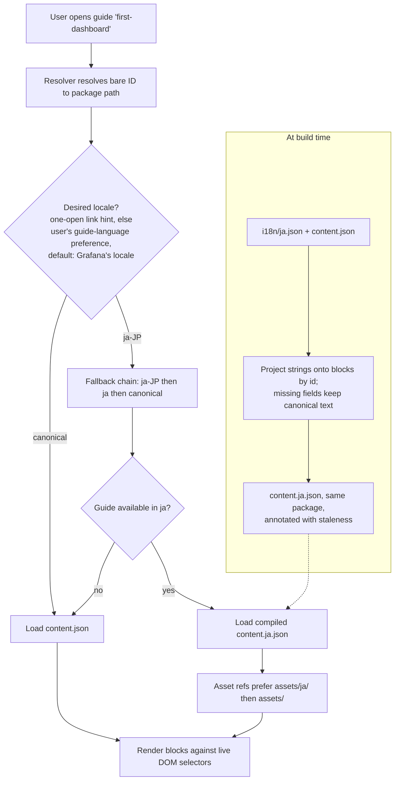

# RFC: Internationalization of Pathfinder guides

**Status:** Draft — revised after review; pilot-gated (§11)
**Author:** David Allen
**Date:** 2026-07-08 (revised 2026-10-28; implementation revision R0, 2026-11-13, Appendix B)
**Source corpus:** distilled from the Pathfinder package format design at [`grafana/grafana-pathfinder-app/docs/design/PATHFINDER-PACKAGE-DESIGN.md`](https://github.com/grafana/grafana-pathfinder-app/blob/main/docs/design/PATHFINDER-PACKAGE-DESIGN.md), the package schemas in [`src/types/package.schema.ts`](https://github.com/grafana/grafana-pathfinder-app/blob/main/src/types/package.schema.ts) and [`src/types/json-guide.schema.ts`](https://github.com/grafana/grafana-pathfinder-app/blob/main/src/types/json-guide.schema.ts), the resolver/loader in [`src/package-engine/`](https://github.com/grafana/grafana-pathfinder-app/tree/main/src/package-engine), the bundled guides under [`src/bundled-interactives/`](https://github.com/grafana/grafana-pathfinder-app/tree/main/src/bundled-interactives), and the app's existing i18next UI localization under [`src/locales/`](https://github.com/grafana/grafana-pathfinder-app/tree/main/src/locales).

---

## 1. Summary

Pathfinder guides are structured, schema-governed JSON packages. Today every guide's content is English-only: the `content.json` blocks carry hardcoded English text, and while `manifest.json` has a declarative `language` field (BCP 47, default `"en"`), nothing in the resolver, loader, or renderer negotiates on it.

Meanwhile the app's *chrome* — buttons, panel labels, tab titles — is already localized through Grafana's i18next catalogs in `src/locales/` across 21 locales including `ja-JP`. There is a visible seam: a Japanese user sees a Japanese UI wrapping an English guide.

This RFC proposes closing that seam by making guide **content** translatable. The core recommendation is a **translation-sidecar model**: the canonical `content.json` remains the single source of a guide's *structure* (block order, CSS `reftarget` selectors, `requirements`, `targeting`), and per-locale sidecar files under a new reserved `i18n/` directory carry *only* the translatable strings. At build time, each sidecar is projected onto the canonical blocks by block `id` and compiled into a complete `content.<locale>.json` in the same package, under the same guide id; at load time the loader only picks a file. A guide is offered in a locale only once every translatable unit is translated and reviewed. Sibling-package translations (a full second package linked by `translationOf`), the escape hatch for guides whose *structure* must diverge per locale, are deferred from v1.

The design reuses the package format's existing grain — open-world extension directories, the already-present `language` field, and the compiled `repository.json` index — and keeps the fragile, language-neutral skeleton of an interactive guide authored exactly once. The format stays provisional until a small Japanese pilot reports (§11).

## 2. Motivation / Why

### 2.1 The localization seam is already visible

The plugin ships `initPluginTranslations` and a full i18next catalog set (`src/locales/en-US/`, `ja-JP/`, `zh-Hans/`, and 18 more). A user who has set Grafana to Japanese gets a Japanese Pathfinder shell. But the guide they open — its title, its markdown, its step tooltips — is English. The localization stops precisely at the content that matters most for *learning*, which is the whole point of the product. Beginners and intermediate users (Pathfinder's stated audience) are the population least able to bridge that gap.

### 2.2 The format already anticipated language, but stopped short

`manifest.json` has carried a `language?: string` field (BCP 47, default `"en"`) since Phase 1. It is declarative only — `src/package-engine/resolver.ts` resolves purely by bare ID → path, with no locale parameter anywhere in `ResolveOptions`. The intent to model language exists; the mechanism to *act* on it does not. This RFC supplies the mechanism.

### 2.3 Interactive guides have a fragile skeleton that must be language-neutral

An interactive block mixes two kinds of fields:

- **Structural:** `action`, `reftarget` (CSS selectors targeting the live Grafana DOM), `requirements`, `targeting`, block ordering, and block `id`.
- **Translatable:** `title`, `content`/markdown, `tooltip`, hints, section titles, step descriptions.

The structural fields are also the *most fragile* part of any guide: `reftarget` selectors break whenever Grafana's UI shifts. Any i18n design that **duplicates** those selectors across N languages multiplies the maintenance burden on exactly the fields most likely to break. A design that authors them **once** does not. This single observation drives the core recommendation.

That only works if the structure is genuinely language-neutral, and today it is not always. A selector that matches visible UI text — an `action: button` step whose `reftarget` is the button's label rather than a CSS selector, or any `:contains()` or `:text()` selector (`:text()` is the interactive engine's own text-matching pseudo-selector, `src/lib/dom/enhanced-selector.ts`) — matches the English Grafana UI only. About a fifth of the guides in `interactive-tutorials` use one (159 of 772 at `08d6fcc1`); `first-dashboard` targets `button:contains("Add query")`. Those steps already break for a user who runs Grafana's UI in Japanese, with or without a translated guide. This RFC therefore makes text-dependent selectors a validation error in any guide that ships a sidecar (§7.1, §9), so that the skeleton a translation shares is one that works in every UI language.

### 2.4 Translated screenshots matter

A Japanese user who runs Grafana in Japanese sees a screenshot of an English UI as a small localization failure. The format therefore supports per-locale asset overrides (§7.3). The pilot (§11) ships English screenshots only: its primary persona runs Grafana's UI in English, so English screenshots match their screen (§6.4).

## 3. Goals and non-goals

### Goals

1. Let a guide author supply a Japanese (or any BCP 47 locale) translation of a guide's user-visible text without re-authoring its structure.
2. Author the language-neutral skeleton — selectors, requirements, ordering, targeting — exactly once, regardless of how many translations exist.
3. Degrade gracefully: a missing string falls back to the package's canonical language string-by-string, never breaking. This is a safety net, not a publishing target: a guide is offered in a locale only when it is fully translated and reviewed (§6.7).
4. Allow per-locale asset (screenshot/diagram) overrides. The mechanism is present; the pilot ships English screenshots only (§2.4).
5. Let the UI discover which locales a guide is available in, from the compiled index alone, without fetching each guide.
6. Change nothing for the hundreds of existing English-only guides — a package with no translations behaves exactly as today.
7. Give translators an ergonomic surface (a flat map of strings) rather than a full block tree to edit.
8. Let each user choose their guide language independently of the Grafana UI language, defaulting to "follow Grafana's locale" (§6.4).
9. Detect translation staleness mechanically, warn (never block) at build time, and disclose it to the reader at view time (§6.8, §9).

### What does success look like?

A user who reads guides in Japanese opens `first-dashboard` and sees the title, prose, and step tooltips in Japanese, driven by the guide's steps against the same live DOM selectors used for the English version, whatever language Grafana's UI is in. A guide is offered in Japanese only once every block is translated and reviewed; until then the Japanese reader gets the English guide, never a mixed-language one. When the English guide later changes, the Japanese guide stays offered, and the steps whose translation is now behind are disclosed as possibly outdated. The guide author added one file (`i18n/ja.json`) and touched nothing structural.

### Non-goals

1. **Machine translation.** This RFC defines the *carrier* for translations, not how they are produced. AI-assisted translation authoring is a natural follow-on (see [AI-Assisted Authoring RFC](./AI-ASSISTED-AUTHORING.md)) but is out of scope here.
2. **Localizing `reftarget` selectors.** Selectors must target `data-testid` and structural DOM, which are locale-independent in Grafana. A selector that matches visible UI text is not, and in a guide that ships a sidecar it is a validation error (§7.1, §9); the fix is a locale-independent selector, never a per-locale one. If a specific locale's Grafana genuinely renders a structurally different UI, that is the sibling-package escape hatch (§6.6, deferred from v1), not the sidecar path.
3. **Right-to-left layout and locale-specific formatting** (dates, numbers). Handled by the existing i18next/Grafana layer, not by this content format.
4. **Retranslating the app chrome.** Already solved by `src/locales/`.
5. **Content and surfaces outside v1.** v1 does not translate HTML or legacy-wrapped content (it has no block ids to key on), App Platform custom guides (they have no build step to compile in; §6.1), `learning-paths/paths.json`, or the bundled `index.json`. Titles served by the recommender stay in the canonical language; this is a known limitation of v1.

## 4. User experience

### 4.1 The guide author

The author has a finished English guide `first-dashboard/` with `content.json` and `manifest.json`. To add Japanese:

1. Create `first-dashboard/i18n/ja.json`.
2. For each block whose text should be translated, add an entry keyed by that block's `id`, with only the translatable fields.
3. Optionally drop localized screenshots in `first-dashboard/assets/ja/`.
4. Add `"translations": ["ja"]` to `manifest.json` (or let `pathfinder-cli build-repository` infer it).
5. Run `pathfinder-cli sync-translations first-dashboard/` to stamp the sync metadata (`_sourceHash`, `_available`, `baseRef` — §6.7, §6.8), then `pathfinder-cli validate first-dashboard/` — the CLI reports coverage ("42 of 51 translatable blocks translated, 40 reviewed"), errors on any structural field that leaked into the sidecar and on any text-dependent selector in `content.json`, and warns on stale translations. `validate` never writes (§9).

The author never copies a selector, a requirement, or a block ordering. When the author later edits the English guide, nothing blocks: existing translations are flagged stale (a warning, never a failure) and keep rendering with a reader-visible disclosure until a translator catches up.

### 4.2 The translator and the reviewer

The translator opens `i18n/ja.json` and sees a flat, shallow map of `id → { field: string }`. They translate strings. They do not navigate a block tree, do not touch JSON structure describing actions, and cannot accidentally break a selector because selectors are not present in their file. Underscore-prefixed fields (`_sourceHash`, `_available`) and `baseRef` are tooling-owned sync metadata (§6.7, §6.8) — the translator ignores them; the CLI maintains them.

A reviewer then marks each block entry they have checked as `reviewed`. The guide is offered in Japanese once every entry is reviewed (§6.7); a later change to an entry's translated text must not keep its flag (§7.1).

### 4.3 The learner — end-to-end flow



The learner sees the guide in Japanese when it is available in Japanese, and in its canonical language when it is not, driving the same steps against the same Grafana DOM.

## 5. Architecture overview

### 5.1 Components and current status

| Component | File(s) | Current state | Change required |
| --- | --- | --- | --- |
| Content schema | `src/types/json-guide.schema.ts` | Block `id` optional for leaf blocks; step `id` optional | Enforce `id` on translatable blocks and steps in guides that ship a sidecar (§6.5) |
| Manifest schema | `src/types/package.schema.ts` | `language` present, `translations` absent; no `title` field | Add `translations?: string[]`; `description`/`category` become translatable via sidecar (§6.9) |
| Sidecar schema | `src/types/translation-sidecar.schema.ts`; projection table, source hash and review predicate in `src/lib/guide-translation/` | Contract defined (R0) | Validation checks, compile, stamping |
| Build | `pathfinder-cli build-repository`; bundling of `src/bundled-interactives/` | Compiles the index and bundles guides; no locale data | Compile each available locale into `content.<locale>.json` (§7.2) |
| Resolver | `src/package-engine/resolver.ts` | Bare ID → path, no locale | Accept desired locale in `ResolveOptions` |
| Loader | Each resolver loads content when `ResolveOptions.loadContent` is set: `src/package-engine/online-cdn-resolver.ts`, `recommender-resolver.ts`, and `resolver.ts` for bundled guides through `src/lib/bundled-package-files.ts` (there is no `loader.ts`) | Loads + validates `content.json` | Select the compiled `content.<locale>.json` by the fallback chain in the online CDN and recommender resolvers, the pilot's Cloud paths (§7.2) |
| Repository index | `repository.json` (compiled); plugin backend proxy `pkg/plugin/package_recommendations.go` | No locale data; `title` from content.json, `description`/`category` from manifest.json; the proxy decodes entries into fixed Go structs and drops fields it does not declare | Add `translations` to the canonical index and to the proxy's decode and response structs (§7.4); post-pilot, emit one complete index per locale (`repository.ja.json`) |
| Validator | `src/validation/validate-package.ts` | Validates content/manifest/assets | Validate sidecars: coverage, review state, structural-field rejection, staleness; reject text-dependent selectors in sidecar-bearing guides |
| Asset resolution | (deferred in current design) | Relative `./assets/x.png` | Prefer `./assets/<locale>/x.png` |

### 5.2 Directory shape

```
first-dashboard/
├── content.json              # canonical: structure + English text (unchanged)
├── content.ja.json           # generated at build from i18n/ja.json; never committed
├── manifest.json             # language: "en", translations: ["ja"]
├── assets/
│   ├── dashboard.png
│   └── ja/
│       └── dashboard.png     # optional per-locale override
└── i18n/                     # NEW reserved name
    ├── ja.json               # Japanese strings, keyed by block id
    └── es.json               # (any additional locales)
```

### 5.3 Sidecar file shape

```json
{
  "schemaVersion": "1.0.0",
  "language": "ja",
  "baseRef": { "commit": "8f2c41d…", "path": "first-dashboard/content.json" },
  "guide": { "title": "最初のダッシュボードを作成する", "reviewed": true, "_sourceHash": "sha256:…" },
  "manifest": {
    "description": "パネルの追加からダッシュボードの保存までを学びます。",
    "category": "はじめに",
    "reviewed": true,
    "_sourceHash": "sha256:…"
  },
  "blocks": {
    "intro-md":       { "content": "# ようこそ\n\nこのガイドでは…", "reviewed": true, "_sourceHash": "sha256:…" },
    "add-panel":      { "content": "パネルを追加します。", "tooltip": "ここをクリック", "reviewed": true, "_sourceHash": "sha256:…" },
    "save-dashboard": {
      "content": "ダッシュボードを保存します。",
      "steps": {
        "open-save":    { "description": "保存ダイアログを開きます。" },
        "confirm-save": { "description": "保存を確定します。" }
      },
      "reviewed": false,
      "_sourceHash": "sha256:…"
    }
  }
}
```

The sidecar carries **only** text-bearing fields, from two sources: `guide` and `blocks` translate `content.json`; the `manifest` block translates the display metadata in `manifest.json` (§6.9). Which fields of each block type are translatable, and how nested steps are addressed, is fixed by the projection table in §7.1. `id`, `type`, `action`, `reftarget`, `requirements`, `targeting`, `depends`, `milestones`, `author`, and block ordering never appear in it — they are structural and belong solely to their canonical file.

Each block entry, the `guide` entry and the `manifest` block also carry `reviewed`, a boolean a reviewer sets once they have checked that entry's translation (§6.7). It is not translatable text and not part of any hash.

**Guide title.** The guide's title is carried as a `guide` entry, `{ title, reviewed, _sourceHash }`, shaped like the `manifest` block and counted as a translatable unit for availability (§6.7). The earlier draft carried it as a bare top-level `title` string. The entry costs translators one more level of nesting; in exchange the title gets what every other translatable unit has: a review mark, so an unreviewed title keeps the guide from being offered, and a source hash, so a changed English title is reported stale. A bare `title` could do neither. The compiled guide's `title` is the translated one, and the English title is kept in the compiled annotation (`canonicalTitle`, §7.2).

Three field families are **sync metadata**, written and maintained exclusively by tooling, never by translators: the per-entry `_sourceHash` (a hash of the canonical text the translation was made from), the per-file `baseRef` (the commit of `content.json` the sidecar was last fully synced against), and the per-file `_available` availability latch. Underscore-prefixed field names are reserved for this purpose. Their semantics are specified in §6.7, §6.8 and §9.

## 6. Key design decisions

### 6.1 Translation strings live in per-locale sidecars, compiled at build time

Translatable text for locale `L` lives in `i18n/<L>.json`, a file separate from the canonical `content.json`. Translators edit only the sidecar. At build time — in `build-repository` and in bundling — the sidecar is projected onto the canonical blocks (§6.2) and compiled into a complete `content.<L>.json` in the same package, under the same guide id. The compiled file is a build artifact: generated, never committed, never hand-edited.

**Why a sidecar.** `content.json` is, per the package design, "what the block editor produces" — deliberately minimal and owned by the editor. Embedding a `{ en, ja, es }` object at every string site (Alternative 10.2) would balloon that schema, touch every block type, and force the editor and renderer to understand multilingual fields. A sidecar leaves `content.json` byte-for-byte unchanged for existing guides and isolates all i18n concerns to a new, opt-in file.

**Why compile at build, not overlay at runtime.** The compiled file is an ordinary `content.json`, so the existing validator and the e2e runner check the localized guide *as a whole*, unchanged — including against a Grafana running its UI in Japanese. A runtime overlay would only ever validate the two inputs separately (Alternative 10.5). Compiling also gives content the same resolution model §7.4 already uses for the index: the fallback chain is resolved at build, and the runtime cost is a file choice. Keeping the compiled file inside the same package lets completion and telemetry identity (`guideSource`, `guideId`) stay intact; compiling into a separate package would split it (§6.6). It does not keep identity on its own, though (§6.6, "Identity rule"). Explicit per-locale files also make bundling a deliberate choice: which locales a bundle carries, and how they are chunked, is decided per bundle rather than by whatever a dynamic import happens to pull in.

**Consequence for callers.** Every source that serves translated guides needs the build step; App Platform custom guides, which have none, are out of v1 (§3 non-goal 5). Staleness is computed when the guide is compiled (§6.8). The loader gains a file selection, not an overlay. The block editor previews a translation by running the same projection function client-side; that is a preview path, not a delivery path.

### 6.2 The projection keys on block `id`, carries text only, and follows a per-type table

The compile step projects sidecar entries onto canonical blocks matched by `id`, replacing only the fields the projection table (§7.1) allows for that block type. Nested blocks — inside sections and conditional branches — are addressed by their own `id` in the same flat `blocks` map; steps inside a `multistep` or `guided` block are addressed by step `id` under their parent's entry.

**Why.** `id` is the stable addressing mechanism the format already uses for edit-block/remove-block operations. Keying on it means the sidecar never restates structure and never restates the *ordering* of blocks — reorder the English guide and every translation follows automatically. Restricting the sidecar to text fields makes it impossible for a translator to break a selector, because selectors are not in their file.

**Why a table, not a generic deep merge.** Addressing is not uniform across block types today: a step's `id` is optional, a quiz choice's `id` is required, a challenge's hints are an id-less array, and sections and conditionals nest whole block lists. A generic deep merge cannot key an id-less array, and a positional merge silently misaligns when the English inserts an item. An explicit table states, per type, which fields translate and how they are addressed, which makes the contract testable. v1 covers only the block types the pilot uses (§7.1); the rest stay in the canonical language until the pilot shows what they need.

**Consequence for callers.** Any block that wants a translation must have a stable `id`, and so must every step of a translated `multistep` or `guided` block (§6.5).

### 6.3 Missing keys fall back to the canonical language, per field

If the sidecar lacks an entry for a block, an entry omits a field, or an entry is not yet `reviewed`, the compiled file keeps the package's canonical-language value for that field. The canonical language is `manifest.language` (default `en`).

**Why.** Translation always lags authoring, and a compiled guide must never show empty strings. Per-field (not per-block) fallback means a translator can translate a step's `content` before its `tooltip` and both states compile correctly.

**Consequence for callers.** Per-field fallback is a **safety net, not a publishing target.** Whether a reader is offered the guide in a locale at all is a separate, stricter rule (§6.7): a mixed-language guide is exactly the first impression a beginner — the audience of §2.1 — cannot recover from, so a guide is not offered in `L` until it is fully translated and reviewed. The CLI reports coverage and review state (§9) so authors can see the gap.

### 6.4 Guide language is a user preference; Grafana's locale is only the default

The desired locale comes from a **Pathfinder-level guide-language preference**. Its default is "follow Grafana's UI locale" (the plugin's current i18next language), and each user can override it — e.g. via a compact language picker in the Pathfinder panel — with the choice persisting across sessions. Resolution then tries a BCP 47 fallback chain — `ja-JP`, then `ja`, then the package's canonical language (`manifest.language`, default `en`): specific region, then base language, then canonical. When the chosen language has no translation for a particular guide, the chain degrades normally — the preference is "use this language *where available*," never an error.

**Link hint.** A guide link may carry a language hint, `?guideLang=<tag>`. The hint selects the guide language for that one open of the guide only: it is never saved as the user's preference, and the next guide the user opens follows the preference again. When a hint selected the language, the language picker is shown so the user can switch. A link from a Japanese article therefore opens the guide in Japanese for a reader whose Grafana UI is in English, and that reader is counted as a Japanese reader.

The chain layers **per field**, not per file. A `ja-JP` sidecar is merged over the `ja` sidecar, which is merged over the canonical text, field by field (the same per-key fallback i18next uses). A sparse `ja-JP.json` that overrides three regional terms therefore inherits everything else from a complete `ja.json`, instead of hiding it.

**Why.** Guide language and UI language are genuinely independent choices. A common case: a Japanese engineer deliberately runs Grafana's UI in English (so labels match team runbooks, docs, and Stack Overflow answers) but wants to *read* long-form instructional prose in Japanese. Hard-coupling guide language to the chrome locale locks that user out in both directions. The fallback chain itself matches how i18next and the browser `Accept-Language` model already work, and lets a single `i18n/ja.json` serve all Japanese regional variants without duplication — a guide only ever needs region-specific files (`pt-BR` vs `pt-PT`) when the content genuinely differs.

**UI-language mismatch.** Because the two languages are independent, a guide's prose cannot assume the reader's screen matches it. For v1, a translator writes each UI label as the English Grafana UI shows it, followed in parentheses by Grafana's own string for that label in the guide's language. An English-UI reader matches the English label; a Japanese-UI reader matches the gloss, which is the text Grafana's own `ja-JP` catalog shows them. Operational values — query text, label matchers such as `walker=jack`, values to type — stay verbatim in every language. Screenshots stay English in the pilot (§2.4). Resolving UI labels as tokens against the reader's UI locale at render time is deferred until label drift is shown to be a problem in practice.

**Consequence for callers.** The loader takes a locale string and resolves the chain internally; it does not know or care whether that string came from the user's explicit preference or the chrome default. Because the build has already layered the chain into each compiled file, resolution is a choice among compiled files (§7.2). The plugin needs a small piece of chrome to express the preference and somewhere to persist it (§12.1).

### 6.5 Translatable blocks must carry a stable `id`

Any block that exposes translatable text and wants to be translatable must have an `id`, and so must every step of a `multistep` or `guided` block. The CLI enforces this only for guides that ship at least one sidecar.

**Why.** The projection (§6.2) cannot address a block or a step without an `id`. Today `id` is optional for leaf blocks (`json-guide.schema.ts` marks it `.optional()` for markdown, image, video, quiz, etc.) and required only for containers. Rather than a disruptive global schema change, we scope the requirement: an English-only guide is unaffected; adding a sidecar triggers the check.

**Consequence for authors.** Adding a translation may require adding `id`s to previously-anonymous blocks. The block editor should auto-assign stable `id`s on save so this is invisible in practice. The CLI can offer an autofix that stamps `id`s.

### 6.6 Sibling-package translation is the escape hatch for structural divergence — deferred from v1

When a locale needs *different steps* — a genuinely different UI flow, not just translated words — the author publishes a separate package with its own bare ID and links it via a new manifest field `translationOf: "<canonical-id>"`. **This mechanism is deferred from v1.** No pilot guide needs structural divergence, and siblings are the one path that splits a guide's identity.

**Why keep it in the design.** The sidecar model assumes the structure is shared. That assumption holds for the overwhelming majority of guides because Grafana's DOM contract is locale-independent once selectors stop matching visible text (§2.3). But it must not become a straitjacket: a locale-specific onboarding flow, or a guide that references locale-specific documentation, needs full structural freedom. The sibling package gives it, at the cost of maintaining selectors twice — a cost the author explicitly opts into only when structure truly diverges.

**Identity rule, recorded now.** Sidecars can keep completion identity because the compiled `content.<L>.json` lives in the same package, under the same id, but this is not automatic. Today the completion, progress and package-detection code recognizes a guide's content file by the literal suffix `/content.json` (for example `src/completion-records/completion-identity.ts`), so a `content.<L>.json` URL would open as an unrelated guide with its own progress. The rule: only the canonical `content.json` URL carries identity — tab URL, progress content key, completion `guideId`, journey milestone key and share link. A localized file URL is a fetch detail, and every entry point where one could arrive normalizes it to the canonical URL plus a locale. A sibling does not — it has its own bare ID, and completion records key on (`guideSource`, `guideId`) with `guideId := manifest.id` ([Completion Records §7.1](./COMPLETION_RECORDS.md#71-completionrecord-kind-target-v1-schema)). When siblings ship, a sibling completes under its canonical `translationOf` id, so switching language never loses completion history; block-level progress stays per package, because block ids do not line up across structurally divergent siblings. That rule amends the Completion Records identity contract, and the amendment is deliberately left until there is a real sibling to make it with. Recording the direction now keeps the escape hatch from shipping later with split history.

**Consequence for callers.** When siblings ship, the resolver, when negotiating a locale, prefers (a) a compiled sidecar translation on the canonical package, then (b) a sibling package whose `translationOf` matches and whose `language` matches the chain, then (c) the canonical language. The two mechanisms compose; neither blocks the other.

### 6.7 Availability: a guide is offered in `L` only when fully translated and reviewed

A guide **becomes available in `L`** when every translatable unit — every block entry the projection table covers, the `guide` entry (§5.3), and the `manifest` block — has a translation for `L` (after per-field layering, §6.4) and is reviewed (§7.1). Once a guide is available in `L`, a later English edit does not withdraw it. Tooling (`sync-translations`, §9) stamps `_available: true` on the sidecar the first time the derived rule holds, and the build treats a stamped sidecar's locale as available even when the derived rule later fails. Blocks that no longer qualify — a block the English adds, a changed block whose retranslation awaits review — render their canonical text and are listed in the compiled `fallbackBlockIds` (§7.2), so the reader is told; changed blocks whose reviewed translation still renders are stale and disclosed (§6.8). Only a human removes the latch, to withdraw a translation. Only availability gates what the reader is offered; per-field fallback (§6.3) remains the safety net underneath.

`pathfinder-cli build-repository` writes the set of available locales into each `repository.json` entry (`"translations": ["ja", "es"]`), and compiles `content.<L>.json` for each of them (§7.2).

**Why fully reviewed.** A partly translated guide puts mixed-language steps in front of a beginner, the reader least able to recover from them (§2.1). A `reviewed` flag per block, with unreviewed blocks treated as untranslated, needs no new invariant: the existing fallback already handles it, and guide-level availability falls out of the block states.

**Why staleness does not withdraw.** If every English edit unlisted a guide's translations, warn-only staleness (§6.8) would become blocking in practice: the English author would unpublish the Japanese guide with every fix. Disclosure, not withdrawal, is the response to lag.

**Why denormalize into the index.** The index is the format's discovery surface — the UI reads it to list and badge guides without fetching each package. Denormalizing locale availability lets the UI show "利用可能: 日本語" or a language picker per guide from the index alone. Denormalization is safe here because `repository.json` is always a compiled artifact, never hand-edited (per the package design's index model).

Each entry in a per-locale index (§7.4) additionally carries a **staleness summary** for that locale (e.g. `"translationStatus": { "staleBlocks": 3, "totalBlocks": 51 }`), computed by `build-repository` from the sidecar sync metadata (§6.8). This is a discovery-time convenience only — the authoritative staleness annotation is the one the compile step writes into the compiled guide itself — so the usual compiled-index trust model applies: it is as fresh as the last build, and never hand-edited.

**Why a latch.** Derivation alone cannot tell a guide that was never complete from one that was complete before a later English edit: a block the English adds, or a retranslation awaiting review, makes the derived state false again in both. The latch records the difference in the sidecar, so the build stays a function of the package files alone (§8, property 7).

**Consequence for callers.** The UI can offer a per-guide language affordance cheaply — including "available but possibly outdated" badging in the language picker — before fetching any package.

### 6.8 Staleness metadata is mandatory, inline, warn-only, and disclosed to the reader

Every translated entry in a sidecar MUST carry a `_sourceHash` — a hash of the canonical text it was translated from — stamped by tooling (`sync-translations`, §9). Each sidecar SHOULD carry a per-file `baseRef` recording the commit of `content.json` it was last fully synced against. When the English text of a block changes, the hash mismatch makes the translation *detectably stale*: a **warning** in `validate` and CI (never a build failure), and a **disclosure** to the reader at view time ("this translation may be outdated," with a path to the English version).

**Why mandatory.** Tooling that is not enforced does not get run, and the guarantee silently degrades to "translations may be stale." A stale translation is worse than a missing one — a missing one falls back to correct English (§6.3), while a stale one renders confidently *wrong* instructions — so unchecked staleness would break the monotonic-degradation property (§8) that the whole design rests on.

**Why warn, never fail.** The author who edits the English guide is generally not the person who translates it. If staleness failed the build, a guide with a sidecar could never be updated without simultaneously updating every translation — which in practice means authors either coordinate translators for every edit or delete sidecars to unblock themselves. Translation always lags authoring; the design accepts the lag and makes it *visible* instead of forbidden. (This is the same resolution gettext reached with its `fuzzy` flag: an English change marks the translation, but never blocks the source edit.) Warn-only must survive `validate --strict`, which promotes every entry in a result's `warnings` to an error (`src/validation/validate-package.ts`): staleness and orphan-key findings are therefore reported as non-blocking messages (`severity: 'warn'`, with a remediation such as `pathfinder-cli sync-translations <dir>`), never as `warnings`.

**Why inline, not a companion file.** A separate `i18n/.hashes.json` is a second file that must itself stay in sync with the sidecars — a self-inflicted drift problem. Inline `_sourceHash` travels atomically with the translation it describes, and a reviewer sees both change in the same diff hunk (mirroring how gettext's `fuzzy` lives next to its `msgstr`). Tampering is self-announcing in one direction: a garbled hash mismatches the source and guarantees a warning. The one thing no hash scheme can catch is deliberately re-stamping a hash to match the current English without retranslating — indistinguishable from a legitimate re-sync — and the mitigation is social: hashes are only ever written by the tool, so a hash change with no accompanying translation change is visible in code review.

**Why disclosed to the reader.** Translation will always lag, and warn-only enforcement is safe only if the staleness eventually surfaces somewhere a *user* can see it — otherwise the warning merely relocates the silence from CI to the reader's screen. The reader, told "this translation may be behind the English version," can decide for themselves how much to rely on it. (OpenTelemetry's documentation localization reached the same design under the same constraints; see §9.)

**Source hash definition (normative).** `_sourceHash` is `sha256:` followed by the 64 lowercase hex digits of SHA-256 over the UTF-8 bytes of a canonical serialization of the covered text. The implementation, with golden vectors, is `src/lib/guide-translation/source-hash.ts`; the compile step, `validate` and `sync-translations` all call it.

- **Covered text.** A block entry covers the canonical block's fields that the projection table (§7.1) lists for its type, and, for `multistep` and `guided`, each step's listed fields. The `manifest` block covers `description` and `category` from `manifest.json`. The `guide` entry covers the `title` of `content.json`. Nothing else is covered: not ids (block or step), not structural fields, not the block type, not `reviewed`.
- **Text.** Each string is normalized to NFC, and every CRLF and lone CR becomes LF. A field that is absent or not a string is omitted, so an absent field and an empty string hash differently.
- **Serialization.** `JSON.stringify` (no whitespace) of an object whose keys are the covered field names in projection-table order — a nested field by its dotted name, `whenTrueSectionConfig.title` — followed, for a step-bearing type, by `steps`: an array, in canonical step order, of one such object per step. For example, a markdown block with content `Café` serializes as `{"content":"Café"}`.
- **Consequences.** Renaming a block or step id keeps the hash (§12.6). Reordering steps changes it. Editing only structure (a selector, a requirement) keeps it.

**Consequence for callers.** The compile step computes per-block staleness during the projection it already performs — it has the canonical text and the sidecar hash in hand — and lists stale blocks in the compiled `content.<L>.json`'s root annotation (§7.2); the renderer stays locale-blind and merely renders the annotation. The compiled file and `content.json` come from the same build, so the annotation is exact for what is served. No external index, manifest field, or metadata file is consulted at runtime: `content.json` plus the sidecar are self-describing for staleness, and the compiled file carries the result. `manifest.json` deliberately carries **no** staleness data — it is the author-touched file, and a staleness field there would force churn on every English edit and create a third copy to drift.

### 6.9 Translatable package metadata rides in the same sidecar

The sidecar carries a `manifest` block holding the manifest's translatable metadata — `description` and `category` — alongside the content-sourced `guide` entry (§5.3). `build-repository` reads it and emits per-locale display strings into the per-locale index files (§7.4).

**Why.** The compiled index entry is split-provenance: `title` comes from `content.json`, `description` and `category` from `manifest.json`. A sidecar that translates only content therefore leaves the *discovery* surface English — a fully translated guide still shows an English title and description in the language picker, the recommendation list, and the milestone list, because all three read the index rather than the package. Localizing the guide but not the card that offers it inverts the point of the work: the user has to read English to find out that Japanese is available.

**Why one carrier, not a manifest `i18n` block.** Two translation carriers with different shapes, different staleness rules, and different validation would be a drift problem introduced on purpose. A single file keeps the translator's surface to one document, lets one `baseRef` (§9.1) describe the whole translation, and preserves §6.8's invariant that `manifest.json` holds no i18n state whatsoever — not strings, not hashes.

**Why nested under `manifest`, not flat.** `_sourceHash` is a hash of specific source text. Flattening `description` beside the guide title would make a single hash span two files with independent edit cadences, so a manifest-only edit would falsely mark the content title stale and vice versa. Nesting also tells the structural-field rejection check (§7.1) which allowlist applies: the manifest's structural fields (`id`, `type`, `depends`, `targeting`, `milestones`, `startingLocation`) are a different set from a block's.

**`author` is not translatable.** A person's or team's name is not a string to localize. It is treated as structural for rejection purposes.

**Consequence for callers.** `build-repository` gains a sidecar read and emits per-locale index files (§7.4). The desired locale must reach index lookup, not just content load — a slightly wider blast radius than §6.1 implied. Metapackages get localization for free, which resolves §12.5. Per-locale index files are post-pilot (§11): during the pilot, the listing, recommendation, and milestone surfaces show canonical-language titles, and the sidecar's `manifest` block is not yet surfaced anywhere.

## 7. Component contracts

### 7.1 Translation sidecar (`i18n/<locale>.json`)

- MUST be valid against `TranslationSidecarSchema` (`src/types/translation-sidecar.schema.ts`): `{ schemaVersion, language, baseRef?, guide?, manifest?, blocks?: Record<blockId, entry>, _available? }`, where an entry holds the block's translatable fields, `steps?: Record<stepId, Record<field, string>>` for `multistep` and `guided` blocks, `reviewed?`, `_sourceHash`, and any tooling field the review-validity mechanism adds. `guide` is `{ title?, reviewed?, _sourceHash? }` (§5.3). An unknown root key fails the schema. Inside a block entry or the `manifest` block every other key parses, so that the checks below report it by name with a precise code rather than as a schema error.
- MUST contain only the text-bearing fields the projection table below allows for the addressed block's type. Presence of any structural field (`action`, `reftarget`, `requirements`, `targeting`, `type`, ordering), or of any field the table does not list for that type, is a **validation error**.
- `language` MUST be a BCP 47 tag and SHOULD match the filename.
- Each block entry, the `guide` entry and the `manifest` block MAY carry `reviewed: boolean` (absent means `false`). An entry that is not reviewed is treated as untranslated: the compiled file keeps canonical text for it (§6.3). Availability in the sidecar's locale is derived from these marks (§6.7).
- **Review validity.** Requirement: a change to an entry's translated text must not keep a stale `reviewed` mark. The mechanism is chosen by the PR that implements it (`sync-translations`, §9). Whatever it is, it lives in one predicate, `isEntryReviewed` (`src/lib/guide-translation/review.ts`), plus the tooling field it needs; the compile step, coverage reporting and every other caller ask the predicate and never read `reviewed` directly. Until that PR, the predicate is `reviewed === true`.
- Every translated entry MUST carry a `_sourceHash` (tooling-stamped; §6.8). A translated entry without one is a **validation error**; a mismatched one is a staleness **warning**, never an error.
- The hash covers the entry's translatable text only — deliberately *not* the block `id` — so that content-addressed rename detection remains possible (§12.6). Its exact definition is in §6.8. Underscore-prefixed fields are reserved for tooling; translators never write them.
- `_available` is a per-file latch, stamped by tooling once and removed only by a human (§6.7).
- `baseRef` is per-file `{ commit, path }`, advisory, and advanced by tooling only when **every** entry's hash is back in sync, including the `guide` entry and the `manifest` block, (so `baseRef..HEAD` always contains whatever made each stale block stale; the per-block hashes filter that diff to the blocks that need attention).
- Unknown block `id`s (present in sidecar, absent in `content.json`) are a **warning** (likely drift).
- MAY contain a `manifest` object carrying `description` and `category` only (§6.9). `author`, `id`, `type`, `depends`, `recommends`, `suggests`, `provides`, `conflicts`, `replaces`, `targeting`, `milestones`, `startingLocation`, `estimatedMinutes`, and `testEnvironment` in that object are a **validation error**.
- The `manifest` block carries its own `_sourceHash`, covering the canonical `description` and `category` text. It is independent of every block hash: a manifest-only edit marks the manifest block stale and nothing else.
- `baseRef.path` names `content.json`, but `baseRef` advances only when the manifest block's hash is in sync too — the diff-driven repair path (§9.1) must widen to `git diff <baseRef.commit>..HEAD -- content.json manifest.json`.
- For a metapackage (`type: "path"` or `"journey"`), the `manifest` block is typically the entire sidecar; `blocks` MAY be absent.

#### Projection table (v1)

v1 translates only the block types the pilot guides use (§11). For each, the table lists the translatable fields and how they are addressed; every other field of the type is structural. The table is exported as data, `PROJECTION_TABLE` in `src/lib/guide-translation/projection-table.ts`, so a pilot revision is a data edit.

| Block type | Translatable fields | Addressing |
| --- | --- | --- |
| `markdown` | `content` | Block `id` |
| `interactive` | `content`, `tooltip`, `hint`, `formHint` | Block `id`. `targetvalue` is an operational value and stays verbatim (§6.4) |
| `section` | `title` | Block `id`. Nested blocks are addressed by their own `id` in the same flat `blocks` map |
| `conditional` | `description`; the `title` in `whenTrueSectionConfig` and `whenFalseSectionConfig`, carried in the entry as `whenTrueSectionConfig.title` and `whenFalseSectionConfig.title` | Block `id`. Blocks in either branch are addressed by their own `id` in the same flat `blocks` map |
| `multistep`, `guided` | `content`; per step: `description`, `tooltip`, `formHint` | Block `id`; steps under `steps`, keyed by step `id` (required when the guide ships a sidecar, §6.5) |
| `image` | `alt` | Block `id`. `src` is localized only through asset resolution (§7.3) |
| `video` | `title` | Block `id` |

Rules that apply across the table:

- **Id-less arrays** are translated whole or not at all. An entry that supplies one must supply the same number of items as the canonical array; on a length mismatch the compile step keeps the canonical array and `validate` warns. No id-less array is translatable in v1, so the rule governs future rows of the table.
- **Block types outside the table** — among them `quiz`, `challenge`, `html`, `grot-guide`, `terminal`, and `snippet-ref` — are not translatable in v1 and render in the canonical language. An entry addressing one is a validation error. A `snippet-ref`'s text belongs to the snippet's own source, so it is translated there, not in the referencing guide's sidecar.

#### Structural rules for a guide that ships a sidecar

- Every translatable block and every step of a `multistep` or `guided` block MUST carry an `id` (§6.5).
- `content.json` MUST NOT use a text-dependent selector: an `action: button` step whose `reftarget` the runtime matches as button text — neither a CSS selector by `isCssSelector` (`src/lib/dom/selector-detector.ts`) nor a `grafana:` token — or any `reftarget` containing `:contains(` or `:text(`. Either is a **validation error**, because it matches only the English Grafana UI (§2.3). An English-only guide is unaffected.

### 7.2 Compile step and loader selection

**Compile step** (in `build-repository` and in bundling):

- Input: canonical `content.json`, the package's sidecars, and `manifest.language` as the canonical language.
- For each locale in which the guide is available (§6.7), layers the BCP 47 fallback chain per field — for `ja-JP`, the `ja-JP` sidecar over the `ja` sidecar over the canonical text (§6.4) — and projects the result onto blocks by `id` according to the projection table (§7.1). Unmatched blocks, unmatched fields, and entries that are not `reviewed` keep the canonical text.
- Compares each entry's `_sourceHash` against the hash of the current canonical text (§6.8). This is the authoritative staleness computation — derived entirely from the package files in hand, with no index or metadata lookup.
- Emits `content.<L>.json` in the same package: a `ContentJson` structurally identical to the canonical one, with localized strings, the translated title, and one root annotation, `translation: { language, canonicalLanguage, canonicalTitle, staleBlockIds, fallbackBlockIds }`. `language` is `L`; `canonicalLanguage` is `manifest.language` (default `en`); `canonicalTitle` is the canonical `title`; `staleBlockIds` lists blocks whose reviewed translation renders but was made from older canonical text; `fallbackBlockIds` lists blocks that render canonical text in a locale kept available by the latch (§6.7). Canonical guides never carry the annotation. `ContentJsonSchema` and `JsonGuideSchemaStrict` declare it, so a read keeps it instead of stripping it. The file is validated, and can be e2e-tested, like any other `content.json`.

**Loader selection** (in the resolvers that load content, §5.1):

- Input: desired locale, package base path.
- Walks the fallback chain and loads the first compiled `content.<L>.json` that exists, or the canonical `content.json`.
- The renderer needs no i18n awareness beyond rendering the `translation` annotation (a per-guide or per-block "this translation may be outdated" affordance, with a path to the canonical-language version; exact treatment and thresholds are a UX decision).

### 7.3 Asset resolution

- When a block references `./assets/<name>`, the resolver, given locale `L`, prefers `./assets/<L>/<name>` (with the same fallback chain) and falls back to `./assets/<name>`.

### 7.4 Manifest / index

`manifest.json` gains optional `translations?: string[]` (advisory; the CLI is authoritative). It carries **no translated strings** (§6.9) and **no staleness data** (§6.8).

`build-repository` emits **one complete index file per locale** — `repository.json` (the canonical language) alongside `repository.ja.json`, `repository.es.json`, and so on. Publishing a package repository publishes the whole set.

**Per-locale index files are post-pilot.** The pilot never fetches one: readers enter a pilot guide by a deep link, and the canonical index's `translations` field drives the language picker. The rest of this section describes the shape that ships after the pilot.

#### Each per-locale index is complete and self-sufficient

Every locale's index contains **every entry**, carrying that locale's strings where a translation exists and the canonical-language strings where it does not. The BCP 47 fallback chain is therefore resolved at **build** time, not at request time: a consumer negotiates once to pick a file, fetches exactly that file, and is done. Entries additionally declare whether the guide is available in that locale (§6.7), so a self-sufficient index stays distinguishable from a fully-translated one:

```json
{
  "first-dashboard": {
    "path": "first-dashboard/",
    "title": "最初のダッシュボードを作成する",
    "description": "パネルの追加からダッシュボードの保存までを学びます。",
    "category": "はじめに",
    "translated": true,
    "translationStatus": { "staleBlocks": 3, "totalBlocks": 51 }
  },
  "advanced-alerting": {
    "path": "advanced-alerting/",
    "title": "Advanced alerting",
    "description": "Route and silence alerts.",
    "translated": false
  }
}
```

A per-locale index is structurally **identical** to `repository.json` — the same bare `Record<packageId, entry>` — with the file's locale carried by its filename rather than by a field inside it. One schema validates every index, and negotiation is filename-driven anyway, so an in-file `locale` field would be a second source of truth for something the path already states. Entries gain two optional fields (`translated`, `translationStatus`); the canonical index simply never sets them. `translated` is true exactly when the guide is available in that locale (§6.7).

`repository.json` itself keeps its existing shape and gains only `translations: string[]` per entry — the locales in which that guide is available (§6.7), which is what drives the language picker. The set of locales the repository publishes is the union of those values, so no top-level field is introduced: the index stays a bare record, and existing readers are unaffected. One reader must change for the field to arrive at all: on Grafana Cloud the browser reads the index through the plugin backend, which decodes entries into fixed Go structs (`pkg/plugin/package_recommendations.go`) and drops every field it does not declare. The proxy must declare `translations` and decode it leniently, so that a malformed value drops only that field, never the whole index.

#### Why per-locale files rather than an inline locale map

Two separate decisions, with two separate reasons, worth keeping distinct:

**Why denormalize the strings at build time at all.** The alternative is resolving sidecars when the index is served. That is not viable against the request path we actually have: the backend proxy already performs a per-package `manifest.json` fan-out to enrich index entries, bounded by a hard total budget, and it already degrades to partial results when that budget expires on a cold cache. Resolving a sidecar per package would double that fan-out against a budget that is already the binding constraint. Build-time denormalization makes the runtime cost of translated metadata exactly zero. This argument is decisive, and it applies to any denormalized shape.

**Why one file per locale rather than one file with an `i18n` map.** Given denormalization, the remaining question is packaging, and three things favour separate files. The index is a client-fetched artifact, and an inline map makes every user download all 21 locales to read one. Separate files cache independently at the CDN, at exactly the granularity of consumption. And `repository.json` stays shape-compatible for every existing English reader, where an inline map would change the shape of every entry — a stronger form of §8's zero-impact property than the inline shape can offer.

#### Costs this shape accepts

- **Publishing becomes an N+1-file operation, governed by an ordering rule rather than a transaction.** A publish writes package directories first, then all index files, and never deletes a package in the same publish that drops it from the indexes; the deletion waits for the next publish. During any skew window, every index entry then points at a package that exists, so a reader sees at worst a slightly stale list, never a 404. The rule needs no format or backend change and keeps the bare-record index shape, at the cost of relying on publisher CI discipline and letting deletions lag one publish. Versioned build directories with a pointer swap, or a build id in each index, would give true atomicity or detectable skew, and are not needed while failure is this benign.
- **Completeness is an invariant that must be enforced, not assumed.** `build-repository` must guarantee that every per-locale index has the same entry set as the canonical one; a validation check should fail the build otherwise. Without it, a partial index silently drops guides for that locale — the one way this shape can violate monotonic degradation (§8, property 3).
- **Consumers must not derive the package base URL by string-stripping the index filename.** `repository.ja.json` and `repository.json` share a base path but not a suffix, and suffix-stripping fails silently rather than loudly. The base URL should be configured or declared, never inferred.

Staleness truth is always the annotation the compile step writes into the compiled guide from the package files themselves (§7.2); the index summary is discovery-time convenience only.

## 8. Cross-cutting properties

These follow from the decisions above and should hold as invariants:

1. **Zero-impact for English-only guides.** No sidecar ⇒ no schema change observed, no new required fields, no compiled file, byte-identical load path.
2. **Single-source structure.** For any guide using sidecars, block order, selectors, requirements, and targeting exist in exactly one place.
3. **Monotonic degradation.** Removing a sidecar, or any key from it, can only cause more of the canonical language (`manifest.language`, default `en`) to render — never an error or an empty string.
4. **Renderer is locale-blind; the loader only selects.** All locale logic — the fallback chain, the projection, and staleness computation — runs in the build's compile step. The loader only chooses a compiled file by locale, and the renderer consumes an ordinary `ContentJson` and draws the annotations the compile step already made.
5. **Selectors are never duplicated by the sidecar path.** Only the deliberate sibling-package escape hatch (§6.6, deferred from v1) duplicates structure, and only when the author opts in.
6. **Discovery without fetch.** Locale availability — and, post-pilot, a staleness summary — is answerable from the compiled index alone.
7. **Staleness is self-describing.** `content.json` plus a sidecar fully determine that sidecar's staleness. The compile step computes it from those two files and writes it into the compiled guide; no external index, manifest field, or metadata file is consulted, at build or at runtime.
8. **Staleness is disclosed, never silent, never blocking.** An English edit never fails a build over lagging translations (§6.8); in exchange, the lag is visible to CI *and* to the reader.
9. **Every localized guide is validated whole.** What a reader loads in a locale is a compiled `content.json` that has passed the same validation as the canonical one, and can be e2e-tested the same way.

## 9. Validation and drift

Interactive guides drift when Grafana's UI changes; translations drift when the English guide changes underneath them. The CLI addresses translation drift specifically:

`validate` stays read-only: it reports and never writes. A separate command, `pathfinder-cli sync-translations`, is the only writer of tooling fields (`_sourceHash`, `_available`, `baseRef`, and any review-validity field, §7.1). It stamps what is missing and never re-stamps a mismatched `_sourceHash` on its own, since that would hide a stale translation; re-stamping is an explicit, reviewable act.

- **Coverage and review report.** `validate` reports translated and reviewed block counts per locale (`ja: 42/51 blocks translated, 40 reviewed, 3 fields missing`), and whether the guide is available in that locale (§6.7). Informational, never blocking.
- **Structural-field rejection.** A structural field in a sidecar, or a field the projection table does not allow for that block type, is an error (§7.1) — this is the primary guard against a translator or tool accidentally forking the skeleton.
- **Text-dependent selectors.** In a guide that ships a sidecar, an `action: button` step that targets button text, or a `:contains()` or `:text()` selector, in `content.json` is an error (§7.1). Such selectors match only the English Grafana UI, so a guide that offers a translation must not depend on them. English-only guides are unaffected.
- **Orphan keys.** A sidecar entry whose `id` is absent from `content.json` is a warning — usually a sign the English guide dropped or renamed a block. Note that hashing does not catch `id` churn (split/merge/rename); see §12.6.
- **Staleness (mandatory, warn-only).** Every translated block carries a tooling-stamped `_sourceHash` of the canonical text it was translated from (§6.8). When the English text for a block changes, `validate` and CI warn that the block's translations are stale — a precise worklist for translators, and the guard against silent divergence, the one real weakness of the sidecar model relative to embedding. Staleness is a **warning, never a failure**, including under `validate --strict` (§6.8): the English author and the translator are usually different people on different timelines, and a failing check would forbid updating any translated guide without simultaneously updating all its translations. Stamping the metadata is mandatory and done by `sync-translations`, never by `validate` or the build; *acting* on a staleness warning is the translator's asynchronous job.

### 9.1 From detection to repair: `baseRef` and diff-driven retranslation

A hash mismatch says *that* the English changed, not *what* changed. The per-file `baseRef.commit` (§5.3) closes that gap: on a mismatch, tooling walks the history of `content.json` across `baseRef.commit..HEAD` and, for each stale block, finds the version of that block's text whose hash matches the block's `_sourceHash`. That version is the "old English" the translation was made from, and the current text is the "new English". Matching by hash rather than taking the text at `baseRef.commit` matters after a partial retranslation: a block retranslated after `baseRef` was made from later English than `baseRef` records, and only its hash says which. No per-block commit field is needed. If no version in that range matches, the block falls back to "stale without diff context" (below). Tooling can then hand a structured bundle — old English, new English, existing translation — to an AI-assisted retranslation step. That bundle is the natural input contract for the `translate-guide` MCP tool (§12.4): targeted repair of only the changed blocks, preserving the untouched remainder of the translation.

This is a proven pattern: OpenTelemetry's documentation localization records a `default_lang_commit` per translated page and diffs against it in CI to detect and describe drift, under the same constraints (long technical content, a small translator pool, a moving English source).

Two operational caveats, and one rule:

- **Shallow clones.** CI checkouts with `fetch-depth: 1` cannot reach `baseRef.commit`, and `interactive-tutorials` CI checks out with the default depth of 1. v1 staleness is therefore hash-only: no v1 rule, review validity included (§7.1), may depend on git history in CI. `baseRef` is stamped by `sync-translations` where history is available and is otherwise left unchanged. The diff-driven repair path below is post-pilot; a repository that adopts it needs sufficient fetch depth.
- **History rewrites.** Rebases and squashes can make `baseRef.commit` permanently unreachable. The specified fallback is **"stale flag without diff context"** — the hash comparison is content-based and still works; only the diff convenience is lost. Never a hard failure. This also keeps the git coupling soft: `baseRef` is advisory diff context, the hash is the source of truth, and a package outside a git repo simply has hash-only staleness.
- **Advance rule.** Tooling advances `baseRef` only when every entry's hash is back in sync; a partial retranslation updates the fixed blocks' `_sourceHash` values and leaves `baseRef` alone (§7.1). This keeps `baseRef..HEAD` a superset of every stale block's changes.

### 9.2 Reader-visible staleness

Warnings to authors are necessary but not sufficient: translation work will always trail the English source, so the reader needs the disclosure too (§6.8). The plumbing is already paid for — the compile step annotates stale blocks in the compiled guide (§7.2), and, post-pilot, `build-repository` denormalizes a per-locale summary into each per-locale index (§6.7, §7.4) so the language picker can badge "available but possibly outdated" before any package is fetched. The renderer surfaces the annotation; how loudly (guide-level banner vs per-block marker, and at what stale-block threshold) is deliberately left to UX — the format's job is to make the data available at both discovery time and render time.

## 10. Alternatives considered

### 10.1 Sibling packages as the default (one full package per language)

**Considered.** Model each translation as a complete standalone package — `first-dashboard` and `first-dashboard-ja` — each with its own `content.json`, linked by `translationOf`. This aligns cleanly with the format's identity model (each is a valid bare-ID package) and with the existing `language` field being package-level.

**Rejected as the default because.** It duplicates the language-neutral skeleton — most importantly the `reftarget` selectors and `requirements` — across every language. Those are the fields most likely to break when Grafana's UI changes (§2.3), so this doubles maintenance on exactly the fragile surface. It also proliferates IDs, which splits completion identity across languages (§6.6), and forces the whole guide to be translated or not, with no graceful per-block fallback. Retained, however, as the deliberate escape hatch for genuine structural divergence (§6.6, deferred from v1), because there it is the *right* tool.

### 10.2 Embed translations inside `content.json`

**Considered.** Turn every translatable string into a locale map, e.g. `"title": { "en": "Add a panel", "ja": "パネルを追加" }`, or add a parallel `translations` map inside `content.json`. One file, one ID, structurally impossible to drift.

**Rejected because.** It is the most invasive option: it changes the `content.json` schema, every block type, the block editor, and the renderer, and it bloats every guide file. It fights the design intent that `content.json` stays the editor's minimal domain. It gives translators a deeply-nested block tree to edit rather than a flat string map, and it makes per-locale *asset* overrides awkward. Its one advantage — structural drift is impossible — is recovered cheaply by the sidecar staleness check (§9).

### 10.3 A gettext/PO-style flat message catalog per guide

**Considered.** Reuse a `.po`-like catalog keyed by source string or by a synthetic message id, mirroring the app's i18next approach.

**Rejected because.** Guide text is long-form markdown, not short UI strings; keying on source text is brittle (any English edit orphans the translation) and keying on synthetic ids reinvents block `id` with a second, parallel identifier. Keying directly on the block `id` the format already has (§6.2) is simpler and ties the translation to the structural unit it belongs to. The i18next layer remains the right tool for chrome; guide content is a different shape.

### 10.4 Runtime machine translation

**Considered.** Skip stored translations; translate on the fly via an MT service when a non-English locale is requested.

**Rejected because.** Quality is unpredictable for technical instructional content, it adds a runtime dependency and latency to guide load, and it cannot localize screenshots. Stored, reviewable translations are the correct primitive; MT is a plausible *authoring aid* for producing sidecars offline (§3 non-goal 1), not a runtime path.

### 10.5 Runtime overlay of sidecars at load time

**Considered.** This RFC's first draft: the loader fetches the sidecar alongside `content.json` and overlays it at load time, for any guide source, with staleness computed live on every load.

**Rejected as the delivery path because.** The localized guide a reader sees is never validated or e2e-tested as a whole — only its two inputs are, separately. It introduces a second resolution model beside the index's build-time one (§7.4). And it leaves the bundling strategy implicit: a naive dynamic import of sidecars pulls every locale into the bundle. Its real advantages — no build step, and staleness as fresh as the content — matter mainly for App Platform custom guides, which are out of v1 (§3 non-goal 5). **Retained for preview:** the block editor runs the same projection function client-side to preview a translation before it is built (§6.1).

Compiling each locale into a *separate* package, rather than into the same one, was also considered and rejected: a new id per locale splits completion and telemetry identity, which the same-package compile keeps intact (§6.6).

## 11. Rollout: pilot gate

The format is designed here, but its newest decisions have no usage evidence behind them yet. Rather than complete the implementation in waves first, Pathfinder runs a small, complete Japanese pilot, and the decisions below stay provisional until it reports. The pilot itself — guides, audience, entry flow, measurement, and acceptance criteria — is a plan, not design, and lives outside this RFC so it can change quickly without churning it. Its current copy is the "Pilot plan" section of the implementation epic, [grafana/grafana-pathfinder-app#2373](https://github.com/grafana/grafana-pathfinder-app/issues/2373).

**What the pilot needs from this design.** Sidecars with `reviewed` and the sync metadata (§5.3, §7.1); the compile step and loader selection (§7.2); the per-field fallback chain (§6.4); the selector and step-id rules (§7.1); `translations` in the canonical index (§7.4); the guide-language preference and picker (§6.4); the one-open `?guideLang=` link hint (§6.4); and reader-visible staleness (§9.2).

**Corrections to the pilot plan.** Recorded here until the plan is next revised:

- **Selectors (plan §4).** The list of known text-dependent selectors missed one: `prometheus-lj/select-private-connection` has an `action: button` step that targets the text "Save & test".
- **Content CI (plan §4).** `interactive-tutorials` builds and validates with the app's `main` branch: `deploy.yml` and `validate-json.yml` check out `grafana/grafana-pathfinder-app` at `ref: main`. Before the pilot, that checkout is pinned to one reviewed app ref, so that an unreleased CLI change cannot break content publishing or content-PR CI.
- **Ownership (plan §8).** Recruitment and observation are owned by Mitsuhiro Tanda's and Yoshi Yamaguchi's team, confirmed on [grafana/pathfinder-rfcs#12](https://github.com/grafana/pathfinder-rfcs/pull/12) on 2026-10-29.

**Provisional until the pilot reports.** These stay open to revision, and this RFC is revised to match what the pilot finds:

- The availability rule — fully translated and reviewed — and the `_available` latch that keeps a guide available after later English edits (§6.7).
- The projection table and the v1 block-type scope (§7.1).
- The UI-language mismatch convention and English-only screenshots (§6.4, §2.4).
- Requiring `id`s only in guides that ship a sidecar (§12.2).

**Deferred until after the pilot.** Per-locale index files, translated index strings, and the publish ordering rule (§6.9, §7.4); sibling packages and the completion-identity amendment they need (§6.6); UI-label tokens resolved at render time (§6.4); and any reader-facing choice to show a partially translated guide (§6.3).

## 12. Open questions

### 12.1 Where does the guide-language preference live?

**Resolved in part.** The product question — auto-select vs choice — is settled by §6.4: guide language is a per-user preference, defaulting to "follow Grafana's locale," overridable via a compact language picker in the Pathfinder chrome, with the choice persisting. **Storage is resolved:** the preference is per-user Grafana user storage through `useUserStorage` (`src/lib/user-storage.ts`, server-side where Grafana user storage is available), holding either `follow-grafana` (the default) or a validated BCP 47 tag. A link hint (§6.4) is never written there. **Still open:** the picker's exact placement and its interaction with the per-guide "view in English" affordance implied by staleness disclosure (§9.2).

### 12.2 Should `id` become globally required?

**Resolved for v1: stays scoped.** §6.5 requires `id`s — on translatable blocks and on the steps of `multistep` and `guided` blocks — only in guides that ship a sidecar, and the CLI offers an autofix that stamps them. Making `id` required for all leaf blocks globally (with an editor autofix migration) would be simpler to reason about and would unlock other id-addressed features, but its migration cost is not justified before the pilot. Revisit after the pilot (§11).

### 12.3 Where does the staleness hash live, and is it mandatory?

**Resolved during review.** Mandatory, inline in the sidecar (`_sourceHash` per translated block, `baseRef` per file), tooling-stamped, warn-only, and committed (the sync metadata is part of the translation's provenance, not a build artifact). See §6.8 and §9; rationale and the WARN-vs-FAIL analysis are recorded there.

### 12.4 Interaction with the MCP authoring surface

**Question.** How should the [AI-Assisted Authoring](./AI-ASSISTED-AUTHORING.md) MCP tool surface expose "add/update a translation"? A `translate-guide` tool that emits a sidecar and round-trips it through `validate` is the obvious shape. The staleness machinery now supplies the repair-path input contract — a per-block bundle of old English, new English, and existing translation, derived from `baseRef` (§9.1) — but the authoring-path contract (whole-guide vs per-block, coverage reporting back to the agent) is still unspecified.

### 12.5 Path and journey translation

**Resolved by §6.9.** Paths and journeys are metapackages whose user-visible text is almost entirely manifest `title`/`description`. Because the sidecar now carries a `manifest` block, a metapackage localizes through exactly the same file and the same staleness machinery as a guide — its sidecar simply has a `manifest` block and no `blocks`. No separate manifest-level `i18n` mechanism is introduced, and no second carrier exists to drift.

**Milestone titles come from the index.** A journey's *milestone list* surfaces each milestone's translated title from the per-locale index (cheap — the data is there per §7.4), not by loading each milestone package (accurate but N fetches). Because per-locale indexes are post-pilot (§11), milestone lists show canonical-language titles during the pilot.

### 12.6 `id` churn: the failure mode hashing cannot catch

**Question.** The staleness hash (§6.8) detects English edits to a block with a *stable* `id`. When the author restructures instead — splitting, merging, or renaming blocks — the old `id` vanishes, the hash comparison never runs, and the system degrades to two disconnected signals: an orphan-key warning ("this sidecar entry matches no block") and a coverage gap ("this new block is untranslated"). Nothing is *silently* lost, but the translator cannot distinguish a rename (translation fully reusable — re-key it) from a split (partially reusable) from a genuine deletion (discard). Deferred for v1. The ingredients for a future rename detector are deliberately preserved: `_sourceHash` covers text only, not the `id` (§7.1), so a pure rename is findable by content-addressing (an orphan's hash exactly matches a new untranslated block's text hash), and the `baseRef` diff (§9.1) exposes restructures directly.

## 13. References and further reading

- [Pathfinder package format design](https://github.com/grafana/grafana-pathfinder-app/blob/main/docs/design/PATHFINDER-PACKAGE-DESIGN.md) — the reserved-name/open-world model, identity model, and repository index this RFC builds on.
- [Package authoring guide](https://github.com/grafana/grafana-pathfinder-app/blob/main/docs/developer/package-authoring.md) — current authoring workflow.
- `src/types/package.schema.ts`, `src/types/json-guide.schema.ts` — the schemas extended here.
- `src/package-engine/` — the resolvers, which resolve and load content and will select a compiled locale file (§5.1, §7.2).
- `src/types/translation-sidecar.schema.ts`, `src/lib/guide-translation/` — the sidecar schema, projection table, source hash and review predicate; `src/lib/guide-translation/fixtures/` holds the golden fixture package.
- `src/locales/` — the app's existing i18next UI localization (the layer this RFC complements, not replaces).
- [AI-Assisted Authoring for Pathfinder Guides RFC](./AI-ASSISTED-AUTHORING.md) — the natural producer of translation sidecars.
- [OpenTelemetry docs localization: tracking source changes](https://opentelemetry.io/docs/contributing/localization/#track-changes) — the `default_lang_commit` pattern that §9.1's `baseRef` mirrors, in production under the same constraints.
- BCP 47 — language tag syntax used for locale negotiation.

---

## Appendix A: Implementation status by design decision

| Decision | Summary | Status |
| --- | --- | --- |
| 6.1 | Strings in per-locale sidecars, compiled at build into `content.<locale>.json` in the same package | Proposed |
| 6.2 | Projection keys on block `id`, text only, per-type projection table | Proposed — v1 block-type scope provisional (§11) |
| 6.3 | Per-field canonical-language fallback, as a safety net | Proposed |
| 6.4 | Guide language is a user preference; one-open link hint; per-field BCP 47 fallback chain (`ja-JP → ja → canonical`); UI-language mismatch convention | Proposed — preference storage resolved, picker placement open (12.1); mismatch convention provisional (§11) |
| 6.5 | Stable `id` required for translatable blocks and steps | Proposed — depends on editor autofix |
| 6.6 | Sibling package as structural escape hatch | Deferred from v1 — identity rule recorded; depends on `translationOf` field |
| 6.7 | Available in `L` only when fully translated and reviewed, then kept available by the `_available` latch; availability in `repository.json`, staleness summary in per-locale indexes | Proposed — provisional (§11); per-locale indexes post-pilot |
| 6.8 | Staleness metadata mandatory, inline, warn-only, reader-visible | Proposed — resolves 12.3 |
| 6.9 | Translatable manifest metadata rides in the same sidecar; index carries per-locale display strings | Proposed — resolves 12.5; per-locale indexes post-pilot |
| §9 | CLI coverage / review / structural-rejection / text-selector / staleness checks; `baseRef` diff-driven repair | Proposed — id churn deferred (12.6) |
| §11 | Pilot gate | Pilot plan in [grafana/grafana-pathfinder-app#2373](https://github.com/grafana/grafana-pathfinder-app/issues/2373) |

## Appendix B: Revision R0

The first implementation revision. Sub-issues of [grafana/grafana-pathfinder-app#2373](https://github.com/grafana/grafana-pathfinder-app/issues/2373) cite these items by number.

| Item | Change | Where |
| --- | --- | --- |
| E1, E2 | One-open `?guideLang=` link hint; added to the pilot's needs | §4.3, §6.4, §11 |
| E3 | The `_available` latch keeps a guide available after English edits; blocks that no longer qualify render canonical text and are listed in `fallbackBlockIds` | §5.3, §6.7, §7.1, §11 |
| E4 | Review validity is a requirement; its mechanism is chosen by the implementing PR and lives in one predicate | §4.2, §7.1 |
| E5 | Normative source-hash definition | §6.8 |
| E6 | The guide title is a `guide` entry with a review mark and a source hash | §5.3, §6.7, §6.9, §7.1 |
| E7 | One root `translation` annotation on the compiled guide | §7.2 |
| E8 | `validate` stays read-only; `sync-translations` writes tooling fields | §4.1, §9 |
| E9 | There is no `loader.ts`; content loads in the resolvers | §5.1, §7.2, §13 |
| E10 | Corpus count corrected; `:text(` is text-dependent; button-text matching defined as the runtime decides it | §2.3, §7.1, §9 |
| E11 | Identity sites test a literal `/content.json`; only the canonical URL carries identity | §6.1, §6.6 |
| E12 | The plugin backend's index proxy drops undeclared fields, so it must declare `translations` | §5.1, §7.4 |
| E13 | Preference storage resolved | §12.1, Appendix A |
| E14 | CI clones are shallow, so v1 staleness is hash-only | §9.1 |
| E15 | Staleness stays non-blocking under `validate --strict` | §6.8, §9 |
| E16, E17, E18 | Pilot plan corrections: a missed text selector, pinning content CI to an app ref, confirmed ownership of recruitment and observation | §11 |
